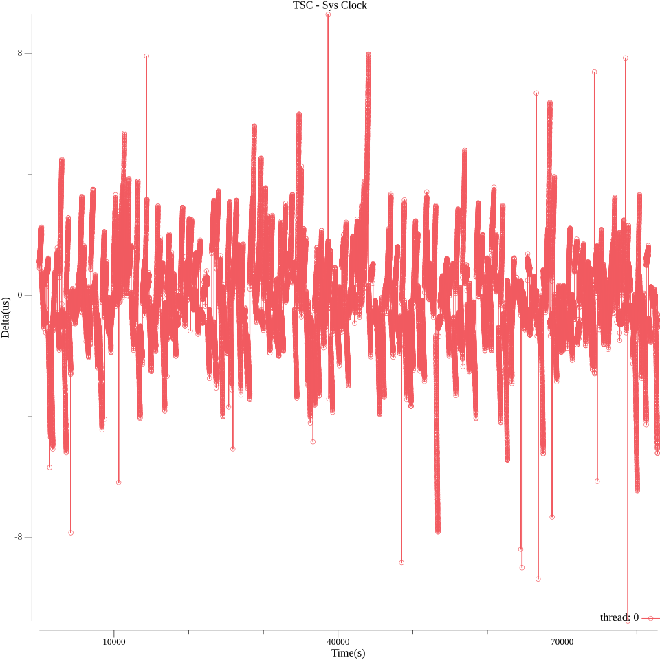

# TSC - High-Performance Unix Time in Go

[](https://pkg.go.dev/github.com/templexxx/tsc)
[](LICENSE)
[](https://github.com/templexxx/tsc/actions/workflows/unit-test.yml)
[](https://goreportcard.com/report/github.com/templexxx/tsc)

TSC is a Go library that provides low-latency, high-precision Unix timestamps using the processor Time Stamp Counter (TSC). In this repository's benchmarks, `tsc.UnixNano()` is typically 6-10x faster than `time.Now().UnixNano()`, which helps time-sensitive workloads reduce timestamp overhead.
## Table of Contents
- [Overview](#overview)
- [Key Features](#key-features)
- [Getting Started](#getting-started)
- [Use Cases](#use-cases)
- [Performance Comparison](#performance-comparison)
- [Clock Drift Analysis](#clock-drift-analysis)
- [Best Practices](#best-practices)
- [Virtual Machine Support](#virtual-machine-support)
- [Limitations](#limitations)
- [References](#references)
- [Related Projects](#related-projects)

## Overview
TSC leverages the processor Time Stamp Counter (TSC) register to generate timestamps with very low overhead. With Invariant TSC support, the library can keep frequency measurements stable across cores and deliver sub-10ns call overhead.
Compared with direct system clock calls, TSC offers more stable invocation cost. Periodic calibration keeps it aligned with the wall clock to control drift over long runs.

 

(`abs(system_clock - tsc_clock)` sampled every second: min 0.00us, max 10.75us, mean 1.18us over 82,800 seconds)

## Key Features
- **Fast path**: 6-10x faster than `time.Now().UnixNano()` in repository benchmarks
- **High precision**: Fine-grained timestamp generation with TSC-backed conversion
- **Stable overhead**: Predictable per-call cost (typically under 10ns)
- **Auto-calibration**: Periodically aligns with the system clock
- **Cross-platform compatibility**: Falls back to standard time functions when TSC is unavailable

## Getting Started

### Basic Usage

``` go
package main

import (
	"fmt"
	"github.com/templexxx/tsc"
)

func main() {
	ts := tsc.UnixNano()   // Unix timestamp in nanoseconds
	fmt.Println(ts, tsc.Supported())  // timestamp and whether TSC path is active
}
```

### With Calibration

See [calibration example](examples/with-calibration.go).

## Use Cases
TSC is ideal for applications where timestamp performance matters:
1. High-performance logging (timestamp field generation)
2. Benchmarking and performance measurement
3. Low-latency applications with frequent timestamp needs
4. Infrastructure services with strict tail-latency budgets

## Performance Comparison

| OS             | CPU                  | time.Now().UnixNano() ns/op | tsc.UnixNano() ns/op | Improvement |
|----------------|----------------------|-----------------------------|----------------------|-------------|
| macOS Catalina | Intel Core i7-7700HQ | 72.8                        | 7.65                 | 89.49%      |
| Ubuntu 18.04   | Intel Core i5-8250U  | 47.7                        | 8.41                 | 82.36%      |
| Ubuntu 20.04   | Intel Core i9-9920X  | 36.5                        | 6.19                 | 83.04%      |
| Fedora 40      | Intel Core i7-12700K | 22.34                       | 5.81                 | 73.99%      |
| Fedora 41      | AMD Ryzen 9 7950X3D  | 29.81                       | 6.27                 | 78.97%      |

## Clock Drift Analysis
TSC provides tools to analyze the stability and drift characteristics in your environment:

- **Linux**: Demonstrates behavior under different hardware quality and frequency stability. On modern hardware, long-run drift can stay around 1us.
- **macOS(X86)**: Shows strong stability with drift typically within 1us in provided tests.
- **Windows**: Not validated in this repository yet; calibration behavior may depend on high-resolution timer support.
- **Calibration effect**: Visualizations show periodic calibration reducing long-run drift.

Detailed drift analysis charts are available in the [tools/longdrift](tools/longdrift/README.md) directory.
## Best Practices
1. **Periodic calibration**: Run `tsc.Calibrate()` regularly (for example every 5 minutes) to keep alignment with wall clock updates such as NTP.
2. **Verify stability**: Use provided tools to verify TSC stability in your environment
3. **Ordered execution**: Use `tsc.ForbidOutOfOrder()` before measuring short code segments.
4. **Fallback awareness**: Check `tsc.Supported()` to confirm whether hardware TSC is active or fallback mode is in use.

## Virtual Machine Support
When running in virtualized environments:
- Some cloud platforms expose stable TSC clock sources (for example AWS EC2)
- CPUID-based feature detection can be limited by VM restrictions
- TSC path is enabled when TSC is detected as the active system clock source
- Validate behavior in your target VM environment before production rollout

## Limitations
1. **Platform support**: Best results are currently observed on Linux with server-grade CPUs
2. **Hardware quality**: Consumer-grade crystals may show higher drift
3. **VM uncertainty**: Behavior in virtualized environments depends on provider implementation

## References
1. [Linux gettimeofday implementation details](https://stackoverflow.com/questions/13230719/how-is-the-microsecond-time-of-linux-gettimeofday-obtained-and-what-is-its-acc)
2. [TSC frequency variations with temperature](https://community.intel.com/t5/Software-Tuning-Performance/TSC-frequency-variations-with-temperature/td-p/1098982)
3. [Further analysis of TSC temperature effects](https://community.intel.com/t5/Software-Tuning-Performance/TSC-frequency-variations-with-temperature/m-p/1126518)
4. [Pitfalls of TSC Usage](http://oliveryang.net/2015/09/pitfalls-of-TSC-usage)

## Related Projects
- [Rust TSC implementation (rtsc)](https://github.com/templexxx/rtsc)
